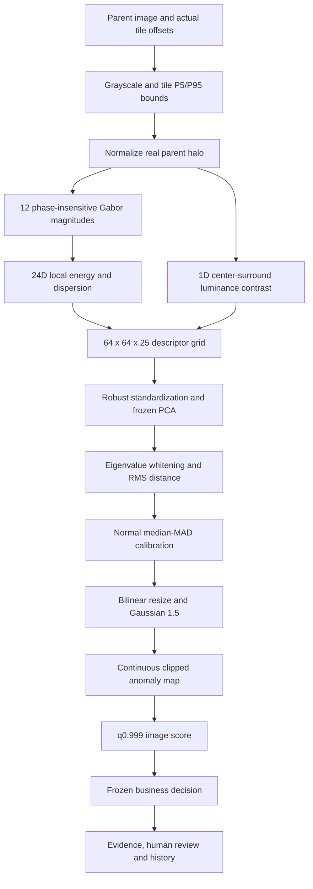

# Final Classical CV pipeline

Frozen Solution 1 with **seven roll-specific normal reference profiles**. The algorithm is identical across profiles; normal-reference statistics, PCA state and the previously fixed operating thresholds are roll-specific. There is no universal PCA model and no alternative active detector.

## Problem, input and output

Find anomalous texture in textile images and provide evidence for an operator. Inspection input is a captured grayscale/RGB image and an explicitly selected validated fabric profile. The benchmark input is a 256×256 tile **plus its real source parent and authoritative offsets**. Parent PNGs remain outside the application in `A:/RAW_FABRID/images`. Filename grid numbers are not reliable crop coordinates; the dataset COCO offsets are authoritative.

Output is a finite float32 continuous anomaly map, q0.999 image score, and a separately computed PASS/REVIEW/HOLD decision with saved evidence. The model does not name a defect, its cause or severity.

## Every stage and its purpose

|Stage|Exact operation and dimensions|Purpose|
|---|---|---|
|Parent context|256×256 tile; up to 20 real pixels around each edge, clipped at physical frame boundaries|Avoid treating internal crop seams as physical image edges|
|Grayscale|Pillow L, float32 integer luminance|One intensity plane; source corpus RGB channels were identical|
|Normalization|Tile P5/P95 bounds applied to the whole real halo; divide by max(P95−P5,1), clip [0,1]|Reduce intensity-scale differences while preserving the frozen normalization rule|
|Gabor|Wavelengths 4,6,8; angles 0°,45°,90°,135°; σ=0.56λ, γ=0.5; phases 0,π/2; 12 magnitude channels|Measure oriented periodic weave without depending on response phase|
|Texture|15×15 local RMS magnitude energy and standard deviation, interleaved per filter: 24 dimensions|Energy measures response strength; dispersion measures local variation|
|Contrast|Absolute difference between lower median in 15×15 center (225 pixels) and surrounding 25×25 minus center (400 pixels)|Add a local luminance cue that texture alone can miss|
|Sampling|Stride 4, offset 2; 64×64×25|Fixed spatial resolution and descriptor order|
|Standardization|Normal feature median and max(1.4826×MAD,10⁻⁶)|Put descriptor coordinates in normal-relative units|
|PCA|Normal-only fitted ≥95% retained variance; 19 PCs for rolls 1–6, 18 for roll 7|Describe correlated normal variation compactly; no rank refit on input images|
|Whitening/RMS|sqrt(mean(z²/max(eigenvalue,10⁻⁶)))|Measure retained-space deviation relative to normal variance|
|Score calibration|max((distance−normal median)/normal MAD scale,0), 64×64|Create a nonnegative anomaly grid in the original calibrated units|
|Map|Bilinear 64×64→256×256; Gaussian σ=1.5; clip [0,25]|Continuous localization map; smoothing and clipping remain frozen|
|Image score|Native float32 map q0.999|Summarize the extreme response without using annotations|

Each existing stage uses its frozen boundary behavior: Gabor and box filtering use REFLECT101; the map blur retains its original OpenCV default. Raw pixels are **not** pre-padded beyond a physical parent boundary before the stage chain. This detail is important for exact reproduction.

The original fitted normal reference has a historical fitting convention: its 24 texture columns used the original tile-context fitting cache, while the added contrast column used real parent context at the same sampled sites. The final artifact is copied unchanged. Commissioning does not attempt to repair or refit that convention.

## Score and decision are different

For 65,536 pixels q0.999 interpolates between the 66th and 67th largest values. It is not a tail mean. Sparse peaks may not cause an alarm, and a low score is not proof of defect-free material. `product/decision.py` applies unchanged per-roll review and hold cutoffs; inference contains no business decision logic. HOLD is the presentation name for the earlier hold-for-confirmation boundary, not automatic rejection.

## Full-frame product operation

The application tiles a full frame into 256×256 windows with the existing 32-pixel overlap, uses real parent pixels for each tile, averages overlapping map values, then applies q0.999 to the merged map. This is an explicit product assembly operation. The published benchmark concerns individual 256×256 tiles with parent context; it does not establish full-frame or independent-line operating performance.

## Entry points

`src/fabric_inspection/vision/classical/engine.py` contains `ClassicalInspectionEngine`. `extract`, `score_features`, `inspect_tile`, `inspect_frame`, and `image_score` show the complete inference flow. The only shipped learned artifact is `models/classical_solution1.joblib`. The only algorithm/policy configuration is `configs/classical_solution1.yaml`.
